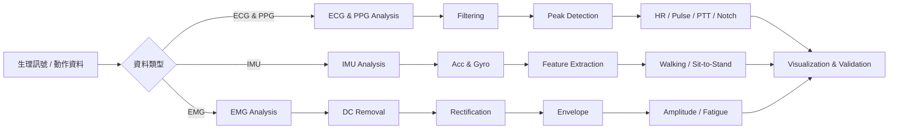
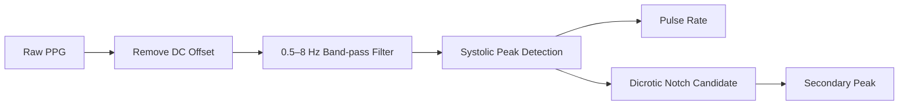
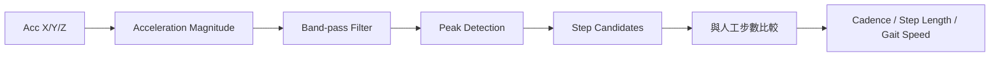
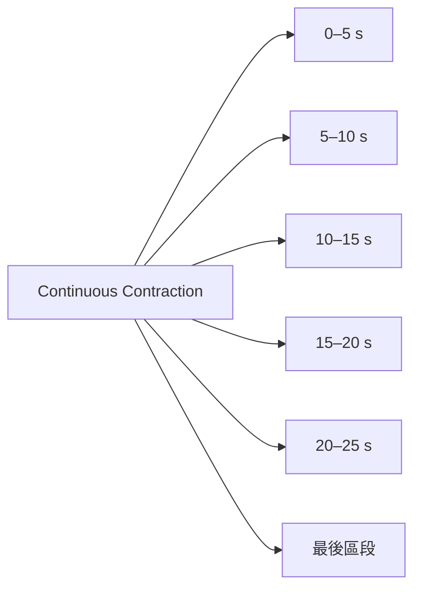

# Biomedical Signal Analysis with MATLAB

使用 MATLAB 進行生醫訊號與人體動作資料分析的實驗專案。

本 repository 整理醫用電子實驗中使用的 MATLAB 分析程式，目前包含：

- **EMG**：肌電訊號量測與分析
- **ECG & PPG**：心電圖、光體積脈波與 PTT 分析
- **IMU**：慣性測量單元與人體動作分析

專案重點不只是取得數值，而是將自動偵測結果重新標示回原始波形，並與實驗現場的人工量測結果比較，以確認程式分析是否合理。

> [!NOTE]
> 本專案主要用於課程實驗、MATLAB 訊號處理練習與生醫工程學習，不作為醫療診斷用途。

---

## 專案內容

| 程式 | 分析對象 | 主要功能 |
|---|---|---|
| [`ECG&PPG.m`](./ECG%26PPG.m) | ECG、PPG | R-wave、Heart Rate、Pulse Rate、PTT、Dicrotic Notch |
| [`IMU.m`](./IMU.m) | Accelerometer、Gyroscope | 六軸特徵、動作週期、步數、步頻、步距、步行速度、起立坐下 |
| [`EMG.m`](./EMG.m) | Surface EMG | DC removal、Rectification、Envelope、振幅、RMS、疲勞趨勢 |

---

# 分析流程總覽



---

# 1. ECG & PPG Analysis

程式：

[`ECG&PPG.m`](./ECG%26PPG.m)

## 輸入資料

目前程式適用三欄 TXT 資料：

```text
Time    Channel_1    Channel_2
```

其中：

```text
Channel_1 = ECG
Channel_2 = PPG
```

程式可一次選擇一個或多個 TXT 檔案，並利用 `Time` 自動計算取樣頻率。

## ECG 分析

ECG 的主要處理流程為：


主要功能：

- 去除 DC offset
- 5–15 Hz Band-pass filter
- 自動偵測 R wave
- 計算 R-R interval
- 排除不合理 R-R interval
- 計算平均心率 Heart Rate
- 將 R-wave 偵測位置標回波形

## PPG 分析

PPG 的主要處理流程為：



主要功能：

- 0.5–8 Hz Band-pass filter
- 自動偵測 PPG systolic peak
- 計算 Pulse Rate
- 偵測 Dicrotic Notch 候選點
- 偵測 notch 後的 secondary peak
- 將所有候選點標回 PPG 波形

## PTT

程式利用 ECG R-wave 與其後 PPG systolic peak 的時間差計算 PTT。

```text
ECG R wave
    │
    │  time difference
    ▼
PPG systolic peak
```

輸出包含：

- Mean PTT
- PTT standard deviation
- Median PTT
- Valid PTT count

> [!IMPORTANT]
> Dicrotic notch 的自動偵測結果屬於「候選點」。
> 局部峰谷可能受到雜訊、濾波與波形形態影響，因此不能只依候選點數量判斷生理性重搏切跡是否存在。

### 分析結果圖片

<!--
將 MATLAB 輸出的代表性圖片放入：

docs/images/ecg_ppg_overview.png

然後取消下面這行註解：


-->


---

# 2. IMU Analysis

程式：

[`IMU.m`](./IMU.m)

使用三軸加速度計與三軸陀螺儀資料進行人體動作分析。

## 輸入資料

目前程式適用實驗系統輸出的 CSV。

CSV 前段包含：

```text
Group
Subject ID
Part
Motion
Trial
Sampling Rate
Recording Duration
Recording Date
Recording Time Start
```

實際六軸資料欄位為：

```text
Timestamp
AccX
AccY
AccZ
GyroX
GyroY
GyroZ
```

程式會自動讀取 metadata，並利用 `Timestamp` 計算實際取樣率。

---

## Part A：基本動作分析

主要分析：

- Acc X / Y / Z
- Gyro X / Y / Z
- Mean
- Standard deviation
- Maximum
- Minimum
- Peak-to-Peak
- Signal Energy
- Peak Number
- Motion Period

程式會比較三軸訊號的變化程度，找出：

```text
Max Acc Axis
Max Gyro Axis
```

可用來觀察不同人體動作或感測器方向下，訊號在 X、Y、Z 軸之間的分配變化。

---

## Part B：Walking Analysis

步行分析使用三軸加速度合成向量：

\[
|a|=\sqrt{AccX^2+AccY^2+AccZ^2}
\]

主要流程：



輸出包含：

- IMU step candidate count
- Step count error
- Error percentage
- Cadence
- Average step length
- Gait speed

> [!IMPORTANT]
> 本實驗 IMU 配戴於手腕，因此手臂擺動產生的峰值不一定與每一步一一對應。
> 自動偵測步數必須與現場人工計數比較。

---

## Part C：Sit-to-Stand Analysis

起立坐下分析會先比較三軸加速度的變化程度，再選擇較具代表性的軸進行分析。

主要流程：


輸出包含：

- 起立坐下候選次數
- 人工完成次數
- 絕對誤差
- 相對誤差

由於不同受試者完成動作的速度不同，固定的 `MinPeakDistance` 或 threshold 不一定適合所有受試者，因此偵測結果仍須進行人工確認。

### IMU 結果圖片

<!--
建議加入：

docs/images/imu_partA.png
docs/images/imu_walking.png
docs/images/imu_sitstand.png

例如：


-->

---

# 3. EMG Analysis

程式：

[`EMG.m`](./EMG.m)

用於分析表面肌電訊號（Surface Electromyography, sEMG）。

## 輸入資料

目前程式適用：

```text
Time
Raw_wave
Rect_wave
```

雖然實驗系統已輸出 `Rect_wave`，程式仍由 `Raw_wave` 重新執行：

```text
Raw EMG
   ↓
DC Offset Removal
   ↓
Full-wave Rectification
   ↓
Moving-average Envelope
```

這樣可以保持訊號處理流程的一致性。

---

## 訊號處理

### DC Offset Removal

\[
x_{DC}=x-\bar{x}
\]

### Full-wave Rectification

\[
x_{rect}=|x_{DC}|
\]

### Envelope

程式預設使用：

```text
150 ms moving average
```

建立平滑的 EMG envelope。

---

## 計算特徵

每份 EMG 資料可計算：

- DC Offset
- Rectified Mean Amplitude
- Maximum Amplitude
- Peak-to-Peak Amplitude
- RMS
- Relative-to-Rest Ratio

---

## 間歇握拳分析

輕度握拳與用力握拳實驗包含：

```text
握拳 5 s
↓
休息 5 s
↓
重複 3 次
```

程式可透過圖形人工選擇三個實際收縮區段，再計算真正活動期間的：

- 平均整流振幅
- 最大振幅
- RMS

這可以避免將休息時間一起平均而低估肌肉活動振幅。

---

## 持續收縮與疲勞分析

持續用力握拳資料會每 **5 秒**分成一個區段。



每個區段計算：

- 整流後平均振幅
- 最大振幅
- RMS

另外比較：

```text
前 5 秒
vs.
最後 5 秒
```

用來觀察持續肌肉收縮過程中的 EMG 振幅變化。

> 肌肉主觀疲勞增加時，EMG 振幅不一定單調增加或下降。實際變化會受到運動單位徵召、放電活動以及受試者能否維持原本出力等因素影響。

### EMG 結果圖片

<!--
建議加入：

docs/images/emg_overview.png
docs/images/emg_envelope.png
docs/images/emg_fatigue.png

例如：


-->

---

# 使用方法

## 1. 下載專案

```bash
git clone https://github.com/Scrype000/Biomedical-Signal-Analysis-MATLAB.git
```

或直接從 GitHub 下載 ZIP。

## 2. 在 MATLAB 開啟資料夾

確認 `.m` 程式與欲分析的資料可正常存取。

## 3. 執行對應程式

### ECG & PPG

```matlab
run("ECG&PPG.m")
```

選擇一個或多個 TXT 檔案。

### IMU

```matlab
run("IMU.m")
```

選擇一個或多個 IMU CSV。

### EMG

```matlab
run("EMG.m")
```

選擇同一受試者的 EMG CSV。

---

# MATLAB 環境

本專案目前使用：

```text
MATLAB R2026a
```

其中 ECG/PPG 與 IMU 分析使用：

```text
Signal Processing Toolbox
```

主要函數包含：

```matlab
butter
filtfilt
findpeaks
```

EMG 分析則主要使用 MATLAB 的：

```matlab
readtable
movmean
ginput
table
```

---

# 結果驗證

本專案將「人工量測」作為自動分析的重要驗證基準。

例如：

| 分析 | 人工驗證方式 |
|---|---|
| ECG Heart Rate | 人工 R-R interval / 心率 |
| PPG Pulse Rate | 人工脈搏觀察 |
| PTT | R-wave 與 PPG peak 波形位置 |
| Dicrotic Notch | 原始 PPG 波形人工確認 |
| IMU Step Count | 現場人工步數 |
| Sit-to-Stand | 現場人工次數 |
| EMG Amplitude | 現場目測振幅 |

自動偵測結果會盡量重新畫回原始或處理後波形，確認 peak 是否對應真正的生理訊號或動作事件。

---

# Repository Structure

```text
Biomedical-Signal-Analysis-MATLAB/
│
├── ECG&PPG.m
│   └── ECG / PPG / PTT / Dicrotic Notch
│
├── IMU.m
│   └── Acc / Gyro / Walking / Sit-to-Stand
│
├── EMG.m
│   └── Rectification / Envelope / Fatigue
│
└── README.md
```

未來可加入：

```text
docs/
└── images/
    ├── ecg_ppg_overview.png
    ├── imu_partA.png
    ├── imu_walking.png
    ├── imu_sitstand.png
    ├── emg_overview.png
    └── emg_fatigue.png
```

---

# 注意事項

不同受試者的生理訊號與動作特徵存在個體差異，因此程式中的 peak detection threshold、`MinPeakDistance`、filter cutoff 等參數不應視為適用所有資料的固定標準。

分析時建議遵循：

```text
自動分析
    ↓
把偵測點畫回波形
    ↓
與人工紀錄比較
    ↓
檢查錯抓 / 漏抓
    ↓
再判斷參數是否需要調整
```

不建議僅為了讓程式輸出符合人工答案而調整 threshold。

---

# Project Status

目前已完成：

| Module | Status |
|---|---|
| ECG Analysis | ✅ |
| PPG Analysis | ✅ |
| PTT Analysis | ✅ |
| Dicrotic Notch Candidate Detection | ✅ |
| IMU Motion Analysis | ✅ |
| Walking Analysis | ✅ |
| Sit-to-Stand Analysis | ✅ |
| EMG Analysis | ✅ |
| EMG Fatigue Analysis | ✅ |
| README Images | 🚧 待加入 |

---

## Disclaimer

本 repository 為生醫工程與醫用電子實驗之學習、訊號處理與程式實作紀錄。

**程式輸出不應作為臨床診斷、疾病判定或醫療決策依據。**
